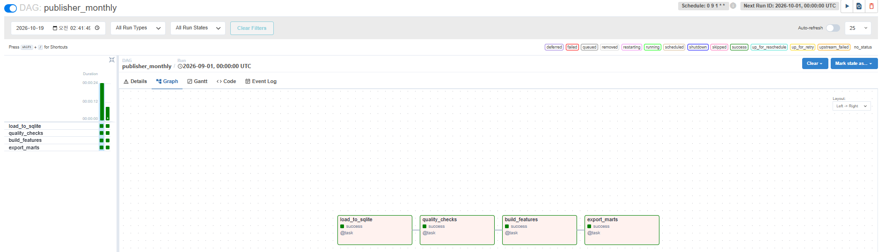

# Airflow 월 배치 파이프라인

서점 SCM 자료 처리 흐름(적재, 품질 점검, 기준일 변수, 월간 지표)을 Airflow DAG로 묶어 매월 자동으로 실행합니다.
분석 코드는 새로 만들지 않고 `교보/코드/sql_layer.py`의 함수를 그대로 부릅니다.



## DAG 구성

`dags/publisher_monthly.py` (매월 1일 09:00 KST, `0 9 1 * *`)

| 순서 | 태스크 | 하는 일 | XCom으로 넘기는 값 |
|---|---|---|---|
| 1 | `load_to_sqlite` | 원본 파일을 읽어 SHA-256 해시를 `load_log`에 기록하고, 테이블을 지운 뒤 SQLite에 다시 적재 | 적재한 원본 파일 수 |
| 2 | `quality_checks` | `sql/quality_checks.sql`의 규칙(규칙 하나에 쿼리 하나)을 실행해 위반 건수를 CSV로 저장 | 전체 위반 건수 |
| 3 | `build_features` | 실행 월 1일을 기준일로 잡고, 기준일 이전 자료만 쓰는 도서별 변수 생성 | 변수를 만든 도서 수 |
| 4 | `export_marts` | 출판사용 월간 지표 뷰 4종을 CSV로 저장 | |

결과는 `교보/결과/airflow/<실행 날짜>/`에 저장됩니다.

## 설계에서 정한 것

- **재실행해도 같은 결과(멱등성)**: 적재 단계가 테이블을 지우고 다시 만들기 때문에 같은 자료로 여러 번 실행해도 결과가 같습니다. 같은 자료로 두 번 실행한 결과 CSV(품질 점검표, 기준일 변수, 월간 지표)가 파일 단위로 같은 것을 확인했습니다.
- **기준일은 Airflow 실행 구간에서 계산**: 현재 시각 대신 `data_interval_end`의 월 1일을 기준일로 써서, 과거 월을 다시 돌려도 그 시점의 변수가 만들어집니다.
- **XCom에는 작은 값만**: 데이터는 SQLite와 CSV에 두고, 태스크 사이에는 건수만 넘깁니다.
- **실패 대응**: 태스크마다 재시도 2회(5분 간격), 동시 실행 1개(`max_active_runs=1`), `catchup=False`.

## 실행 방법

Docker Desktop이 필요합니다. Airflow 공식 `docker-compose.yaml`(2.10.5)에서 세 곳을 바꿨습니다.

- `AIRFLOW__CORE__LOAD_EXAMPLES: 'false'`
- `_PIP_ADDITIONAL_REQUIREMENTS`: `numpy==1.26.4 scikit-learn==1.5.2 scipy==1.13.1 xlrd openpyxl`
- 저장소 루트를 `/opt/airflow/marinebooks`로 마운트

```bash
cd airflow
echo AIRFLOW_UID=50000 > .env
docker compose up airflow-init
docker compose up -d
# http://localhost:8080 (airflow / airflow)
docker compose exec airflow-scheduler airflow dags test publisher_monthly 2026-10-01
```

협력사 원본 자료(`교보/원본`)는 저장소에 없으므로, 자료가 없는 환경에서는 첫 태스크에서 멈춥니다.

## 진행 중 생긴 문제

- **증상**: DAG를 불러올 때 `numpy.dtype size changed, may indicate binary incompatibility` 오류로 DAG가 등록되지 않았습니다.
- **원인**: 버전을 지정하지 않고 추가 패키지(scikit-learn, scipy)를 설치하면서, 컨테이너 안의 numpy와 pandas가 서로 다른 numpy 버전 기준으로 빌드된 상태가 됐습니다.
- **조치**: 기본 이미지의 numpy 1.26.4에 맞춰 추가 패키지 버전을 고정했습니다.
- **배운 점**: `_PIP_ADDITIONAL_REQUIREMENTS`는 기존 패키지를 덮어쓸 수 있으므로 기본 이미지 버전을 먼저 확인하고 고정합니다. 운영 환경이라면 이미지를 따로 빌드하는 것이 맞습니다.
