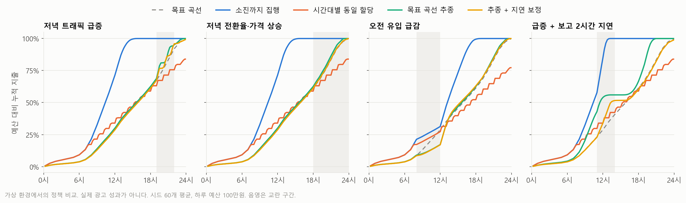
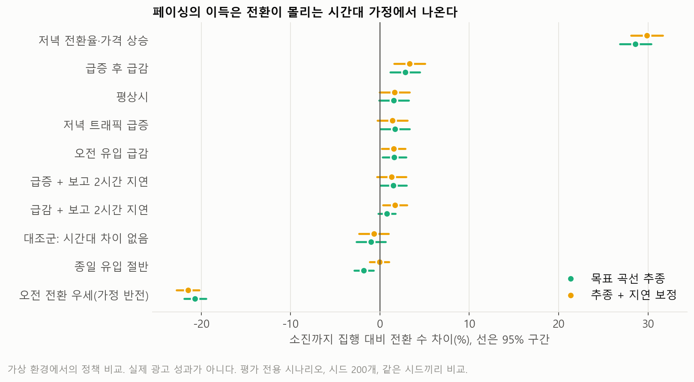
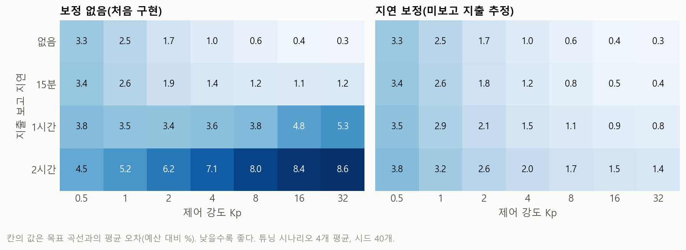
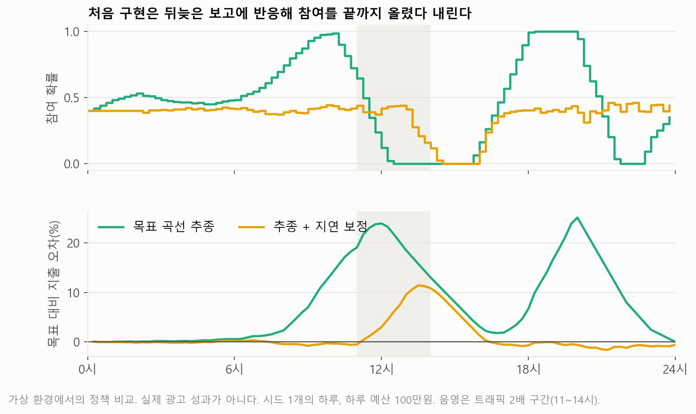

# 광고 예산 페이싱 시뮬레이터

하루 광고 예산을 언제 쓸지 정하는 정책을 가상 환경에서 비교한다. 평균 성과만 보지 않고, 제어 로직이 어떤 상황에서 과하게 반응하거나 늦게 대응하는지를 함께 본다.

이 결과는 가상 환경에서의 정책 비교다. 유입, 가격, 전환율은 모두 가정값이며 실제 광고 데이터로 보정하지 않았다. 실제 광고 효율이나 매출 개선으로 해석하면 안 된다.

## 결론

1. 페이싱의 전환 이득은 전환이 몰리는 시간대 가정에서 나온다. 저녁 전환율이 높다고 가정하면 +29%, 오전이 높다고 가정하면 -21%, 시간대 차이가 없으면 0에 가깝다. 실제 시간대별 전환 자료 없이 "페이싱이 전환을 늘린다"고 말할 수 없다.
2. 튜닝 조건에서 가장 좋았던 제어 강도는 지출 보고가 2시간 늦어지면 무너진다. 목표 오차가 1.2%에서 8.0%로 늘고, 하루의 28%를 참여 0 또는 1에 붙어 보낸다.
3. 지연 보정을 넣으면 목표 오차는 크게 줄지만 전환 수는 늘지 않는다. 목표 추종을 잘하는 것과 성과가 좋은 것은 별개다.
4. 하루 3,333원(월 10만원) 규모에서는 페이싱을 논할 단계가 아니다. 하루 전환이 0.3건이라 10% 차이를 확인하는 데 정책당 약 4,900일이 걸리고, 지연 보정은 오히려 더 흔들린다.

## 비교한 정책

| 정책 | 동작 |
|---|---|
| 소진까지 집행 | 예산이 떨어질 때까지 모든 기회에 참여 |
| 시간대별 동일 할당 | 하루 예산을 24시간에 똑같이 나눔. 남은 시간 예산은 넘기지 않음 |
| 목표 곡선 추종 | 목표 누적 지출과 보고된 지출의 차이로 참여 확률 조정. Kp 8, Ki 0 |
| 추종 + 지연 보정 | 아직 보고되지 않은 지출을 자기 참여 확률과 예측 곡선으로 추정해 더함. Kp 16, Ki 0.5. 튜닝 실패 분석 후 추가 |

## 가상 환경

- 하루를 15분 구간 96개로 나눈다. 구간마다 광고 기회가 포아송 분포로 도착하고, 정책은 참여 확률을 정한다.
- 참여한 기회는 가격을 지불하고 시간대별 확률로 전환된다. 하루 예산을 넘는 집행은 막는다.
- 같은 시드는 같은 기회와 난수를 쓴다. 정책 차이에 도착 난수 차이가 섞이지 않는다.
- 정책은 평상시 유입 곡선만 예측값으로 알고, 지출은 보고 지연을 거쳐 관측한다.

| 가정 | 값 | 근거 |
|---|---|---|
| 기회당 가격 | 중앙값 200원, 로그정규(σ 0.5), 평균 227원 | 가정 |
| 기준 전환율 | 2%, 저녁 최대 1.2배 | 가정 |
| 공급 여유 | 전 기회 지출이 예산의 2.5배 | 가정 |
| 하루 유입 예측 오차 | 로그정규(σ 0.1) | 가정 |
| 큰 예산 | 하루 100만원 | 정책 차이를 보기 위한 값 |
| 작은 예산 | 하루 3,333원 | 마린북스 교보 ROI 분석의 시리즈 월 10만원 광고 |
| 본전 CPA | 4,600원 | 마린북스 교보 분석의 권당 공헌이익 중앙값 |

Hillstrom 이메일 실험은 입력으로 쓰지 않았다. 시간대, 입찰, 광고비가 없는 자료이기 때문이다. 예스24 광고 집행 내역도 0건이라 보정에 쓸 수 없다.

## 실험 설계

튜닝과 평가의 시나리오와 시드를 나눴다.

| 단계 | 시나리오 | 시드 |
|---|---|---|
| 튜닝 | 평상시, 트래픽 급증, 저녁 전환율 상승, 유입 급감 | 40개 |
| 최종 평가 | 평상시, 대조군(시간대 차이 없음), 저녁 트래픽 급증, 저녁 전환율·가격 상승, 오전 유입 급감, 급증 후 급감, 종일 유입 절반, 오전 전환 우세, 급증 + 보고 2시간 지연, 급감 + 보고 2시간 지연 | 큰 예산 200개, 작은 예산 2,000개 |

제어 강도는 실행 전에 정한 기준으로 골랐다. 튜닝 시나리오 평균 목표 오차가 최소인 조합을 고르고, 오차가 0.1%p 안이면 변동성이 낮은 쪽을 택한다. 지연 보정판도 같은 기준을 적용했다. 최종 평가를 본 뒤 정책과 설정은 바꾸지 않았다.

지표는 소진율, 목표 곡선과의 평균·최대 오차, 전환 수, CPA(총지출 ÷ 총전환), 95% 소진 시각, 참여 확률 변동(구간 간 평균 변화량), 포화 구간(참여 0 또는 1인 비율), 복구 시간(교란 시작부터 오차가 3% 안으로 들어와 끝까지 머물기까지)이다.

목표 곡선 오차는 추종 정책이 맞추려는 값 자체이므로 공정한 성과 지표가 아니다. 그래서 전환 수와 CPA를 함께 본다.

## 결과: 하루 예산 100만원



평상시 시나리오, 시드 200개 평균이다.

| 정책 | 소진율 | 목표 오차 | 전환/일 | CPA | 95% 소진 시각 |
|---|---|---|---|---|---|
| 소진까지 집행 | 100.0% | 23.0% | 89.4 | 11,186원 | 13.7시 |
| 시간대별 동일 할당 | 84.2% | 6.2% | 77.8 | 10,819원 | 도달 못함 |
| 목표 곡선 추종 | 100.0% | 1.1% | 90.8 | 11,013원 | 22.3시 |
| 추종 + 지연 보정 | 99.9% | 0.3% | 90.9 | 10,993원 | 22.7시 |



소진까지 집행과 비교한 전환 수 차이다. 같은 시드끼리 비교했다.

| 시나리오 | 목표 곡선 추종 | 추종 + 지연 보정 |
|---|---|---|
| 저녁 전환율·가격 상승 | +28.6% | +29.9% |
| 급증 후 급감 | +2.8% | +3.3% |
| 평상시 | +1.6% (구간이 0 포함) | +1.6% (구간이 0 포함) |
| 대조군: 시간대 차이 없음 | -1.0% (구간이 0 포함) | -0.7% (구간이 0 포함) |
| 종일 유입 절반 | -1.8% | 0.0% (구간이 0 포함) |
| 오전 전환 우세 | -20.7% | -21.5% |

대조군에서 차이가 사라지는 것은 환경이 의도대로 움직인다는 점검이기도 하다. 시간대 차이가 없으면 언제 쓰든 전환 수가 같아야 한다.

## 실패 사례

### 1. 과잉 반응: 튜닝 때 좋았던 값이 보고 지연에서 무너진다





- 현상: 보고 지연 15분에서 고른 Kp 8의 목표 오차가 2시간 지연에서 1.2%에서 8.0%로 늘었다. 평가 시나리오(급증 + 2시간 지연)에서는 최대 오차 26.9%, 포화 구간 28.6%, 95% 소진 시각이 목표보다 2시간 이상 빠른 19.9시였다.
- 원인: 지금 시점의 목표와 2시간 전 지출을 그대로 비교했다. 늘 뒤처진 것으로 보여 참여를 올리고, 뒤늦게 보고가 들어오면 참여를 0까지 내린다. 트래픽 급증 전인 오전부터 오차가 벌어진다.
- 조치: 아직 보고되지 않은 구간의 지출을 자기 참여 확률과 예측 곡선으로 추정해 더했다. 목표만 과거로 옮기는 방법도 비교했지만 2시간 지연에서 오차 2.5%, 포화 12.5%로 추정 방식(1.7%, 0.4%)보다 나빴다.
- 결과: 같은 평가 시나리오에서 목표 오차 8.2%→2.1%, 최대 오차 26.9%→13.4%, 포화 28.6%→8.2%가 됐다.
- 한계: 전환 수는 91.0에서 90.8로 차이가 없다. 소진율은 99.2%로 조금 줄었고, 4.5%의 날은 끝까지 목표 3% 안으로 돌아오지 못했다. 예측 곡선이 틀리면 추정도 틀리기 때문이다.

### 2. 늦은 대응: 공급이 끊기면 제어로 할 수 있는 일이 없다

- 오전 유입 급감(80% 감소): 두 추종 정책 모두 최대 오차가 11~12%까지 벌어진다. 복구에 7.5시간(지연 보정 5.6시간)이 걸린다. 기회가 없으면 참여 확률을 올려도 쓸 수 없고, 유입이 돌아온 뒤에야 따라잡는다.
- 급증 후 급감: 복구 시간이 약 12시간으로 사실상 하루 끝까지 간다.
- 종일 유입 절반: 비례 제어만 쓰면 뒤처진 상태가 유지된다. 소진율 96.6%, 63%의 날이 끝까지 목표로 돌아오지 못했고, 전환도 소진까지 집행보다 1.8% 적다. 적분항이 있는 지연 보정판은 소진율 98.3%, 미복귀 5.5%로 나아졌다. 공급이 빠듯한 날에는 아끼지 않는 쪽이 낫다.

### 3. 가정이 뒤집히면 페이싱이 진다

오전 전환이 높은 세계에서는 추종 정책이 소진까지 집행보다 전환이 약 21% 적다. 목표 곡선이 유입만 따르고 전환율을 모르기 때문이다. 제어를 아무리 잘해도 목표 곡선이 틀리면 소용이 없다.

### 4. CPA만 보면 틀린 정책을 고른다

작은 예산에서 시간대별 동일 할당의 CPA는 5,135원으로 다른 정책의 절반이다. 그러나 소진율은 21%, 전환은 소진까지 집행보다 56% 적다. 시간당 예산 139원이 기회 가격 200원보다 작아 값싼 기회만 사게 되는데, 이 환경에서는 가격과 전환이 독립이라 CPA가 좋아 보인다. 실제로는 값싼 기회의 전환율이 같다고 볼 근거가 없다. 이 값은 환경의 단순화가 만든 착시이므로 좋은 결과로 읽으면 안 된다.

### 5. 작은 예산에서는 개선안이 오히려 나쁘다

평상시 시나리오, 하루 3,333원, 시드 2,000개 평균이다.

| 정책 | 소진율 | 목표 오차 | 전환/일 | CPA | 참여 변동 | 포화 구간 |
|---|---|---|---|---|---|---|
| 소진까지 집행 | 98.9% | 21.5% | 0.31 | 10,618원 | 0.000 | 100% |
| 시간대별 동일 할당 | 21.3% | 28.3% | 0.14 | 5,135원 | 0.000 | 100% |
| 목표 곡선 추종 | 96.5% | 4.6% | 0.29 | 10,923원 | 0.093 | 25% |
| 추종 + 지연 보정 | 95.6% | 4.7% | 0.30 | 10,582원 | 0.122 | 46% |

낙찰 1건이 예산의 약 7%를 차지한다. 지출이 계단처럼 움직여 큰 예산에서 맞춘 제어 강도로는 참여 확률이 크게 흔들린다. 보고 2시간 지연 + 급증에서 지연 보정판의 소진율은 92.1%로 처음 구현(97.7%)보다 낮다. 튜닝 시나리오에서 Kp를 0.5~32로 바꿔도 전환은 0.29~0.32건으로 달라지지 않았다.

## 개선 판단

| 상황 | 판단 | 근거 |
|---|---|---|
| 보고 지연 1시간 이상, 큰 예산 | 지연 보정 사용 | 목표 오차와 포화가 크게 줄고 전환 손해가 없음 |
| 보고 지연 15분 이내 | 단순 추종으로 충분 | 전환 차이가 없고, 지연 보정판은 참여 변동이 0.014에서 0.025로 커짐 |
| 공급이 빠듯하거나 유입이 예측보다 크게 적은 날 | 추종의 강도를 낮추거나 적분항 사용 | 비례 제어만 쓰면 뒤처진 채 하루가 끝남 |
| 시간 예산이 기회 가격보다 작은 소액 | 제어를 쓰지 않음 | 효과를 확인할 수 없고 제어가 흔들림 |
| 시간대별 동일 할당(이월 없음) | 쓰지 않음 | 유입이 적은 밤에 예산을 못 써 큰 예산에서도 소진율 84%, 전환 13% 손해 |

페이싱을 넣기 전에 해야 할 일은 시간대별 전환 자료를 모으는 것이다. 이 자료 없이는 목표 곡선의 방향조차 정할 수 없다.

## 소액 광고에 대한 참고

- 현재 가정의 CPA는 약 11,300원으로 본전 4,600원의 2배가 넘는다. 어떤 정책을 써도 메우지 못하는 차이다.
- 같은 가격에서 본전이 되려면 전환율이 약 4.9%여야 한다. 가격과 전환율 모두 가정값이므로 이 계산은 광고 집행을 권하거나 말리는 근거가 아니라, 무엇을 먼저 확인해야 하는지를 보여 준다.
- 전환 10% 차이를 검출하려면(양측 5%, 검정력 80%) 정책당 하루 100만원 규모에서 약 18일, 하루 3,333원 규모에서 약 4,900일이 필요하다.

## 만들면서 고친 문제

| 문제 | 원인 | 조치 |
|---|---|---|
| 동일 할당이 18.8시에 예산을 소진 | 지연된 보고로 시간 상한을 판단해 상한의 2배를 썼다 | 시간 상한도 하루 예산처럼 집행 시스템이 실제 지출로 막도록 변경 |
| 작은 예산의 동일 할당 CPA가 547원으로 표시 | 일별 CPA 평균을 내면서 전환 0건인 날의 지출이 빠졌다 | 총지출 ÷ 총전환으로 변경, 테스트 추가 |
| 남은 돈보다 비싼 기회를 만나면 그 구간 집행이 멈춤 | 누적합으로 잘라 뒤의 값싼 기회까지 막혔다 | 건너뛰고 다음 기회를 보도록 변경 |
| 작은 예산에서 소진 시각이 거의 안 잡힘 | 99.9% 기준인데 마지막 몇 원을 쓸 수 없다 | 95% 도달 시각으로 변경 |

최종 평가는 두 번 실행했다. 두 번째는 검증 기간 계산식만 바꾼 것이고, 정책별 요약표가 파일 단위로 같음을 확인했다.

## 한계

- 입찰을 다루지 않는다. 집행 강도는 참여 확률뿐이고, 경쟁 입찰과 낙찰 가격 변화는 없다.
- 전환은 즉시 일어나고 가격과 독립이다. 전환 지연과 광고 소재, 사용자 차이는 없다.
- 하루 단위로 초기화된다. 다음 날로의 학습과 이월은 없다.
- 복구 시간은 끝내 돌아온 날만 평균했다. 미복귀 비율을 함께 봐야 한다.
- 시드와 시나리오 수는 정책 비교에 충분하지만, 환경 자체의 타당성을 보여 주지는 않는다.

## 실행

```bash
pip install -r requirements.txt
cd 코드
python -m unittest test_sim
python experiment.py dev
python experiment.py final
python figures.py
python -m streamlit run app.py --server.address localhost
```

데모에서는 예산, 시나리오, 보고 지연, 제어 강도, 가정값을 바꿔 정책별 지표와 누적 지출, 참여 확률을 볼 수 있다. 시나리오를 직접 설정할 수도 있다. README의 수치는 데모가 아니라 아래 실행에서 나왔다.

- 튜닝: `결과/20261103-162314-a85b50`
- 최종 평가: `결과/20261103-162639-704608`

결과 표(csv·json)는 저장소에 올리지 않았다. 위 명령을 실행하면 같은 시드로 `결과/` 아래에 새로 만들어진다.

## 폴더

```
광고페이싱/
├─ 코드/
│  ├─ sim.py          환경, 정책, 지표
│  ├─ experiment.py   튜닝과 최종 평가
│  ├─ figures.py      그림
│  ├─ app.py          데모
│  └─ test_sim.py     테스트 16개
├─ 결과/<실행 ID>/     실행마다 생기는 표(저장소 제외)
└─ 그림/               README 그림
```
